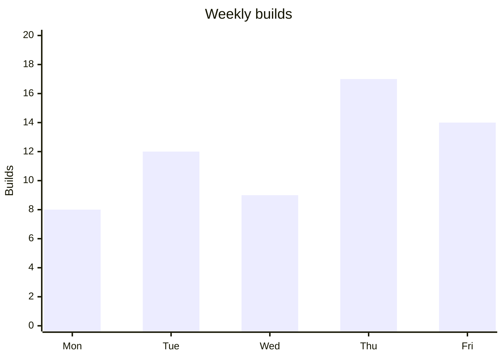

# Experimental Conversation GUI

Any pane of a **Codex**, **Claude Code**, **Pi**, or **Antigravity** preset in a local project can show its agent as a Conversation instead of a terminal: use the **Terminal / Conversation** switch in the pane's header, **View → Switch Pane: Terminal / Conversation**, or **Cmd/Ctrl+Alt+G** (see [Switching a pane between terminal and conversation](#switching-a-pane-between-terminal-and-conversation)). In Settings → Presets, **Opens as** picks the mode a new pane of that preset starts in; Terminal remains the default. Each agent runs over its native structured local wire protocol while keeping ownership of its own tools, sandbox and permissions:

- **Codex (`codex`)**: `codex app-server --listen stdio://` (`CODEX_HOME`, dynamic tools `aya_present`, `aya_open_artifact`, `aya_progress`).
- **Pi (`pi`)**: `pi --mode rpc` (`PI_CODING_AGENT_DIR`, bundled Aya Pi extension registering `aya_present`, `aya_open_artifact`, `aya_progress` and interactive `extension_ui_request` tool approvals).
- **Claude Code (`claude`)**: `claude --input-format stream-json --output-format stream-json --verbose --include-partial-messages --permission-prompt-tool=stdio --chrome` (`CLAUDE_CONFIG_DIR`, in-band SDK MCP server `aya` for `aya_present`, `aya_open_artifact`, `aya_progress` and `can_use_tool` interactive approvals/questions).
- **Antigravity (`agy`)**: `agy --input-format stream-json --output-format stream-json` (`ANTIGRAVITY_GEMINI_DIR`, `step_update` streaming, `denied_actions` permission prompts, `ask_question` prompts, and `aya_present` / `aya_open_artifact` / `aya_progress` tool steps).

## Switching a pane between terminal and conversation

Both modes share one header: the preset's icon and the pane's name, what the agent is doing, its [local servers](#local-servers), the **Terminal / Conversation** switch and the **Artifacts** button. Controls only a conversation has (view options, context meter, restart, history) appear only in Conversation mode.

While a pane switches, its header stays where it is with the new mode already selected and a spinner on it, and the body fades to a short "Opening conversation… / Starting terminal…" placeholder until the other mode is ready (connected with its history, or the terminal's first output); with reduced motion it switches without fading. Switching stops the agent between turns and starts it in the other mode on the same session, so it keeps the whole conversation:

- **Claude Code** resumes the session id in both directions (`claude --resume <id>` in the terminal, `--resume <id>` over stream-json in the conversation).
- **Codex** resumes the same thread: `codex resume <id>` in the terminal, `thread/resume` in the conversation. Both read the same rollout.
- **Pi** and **Antigravity** resume the conversation's session in the terminal (`pi --session <id>`, `agy --conversation <id>`). Their terminals do not tell Aya which session they are in, so going from the terminal to a conversation starts a new conversation, and the pane says so.

Going to the conversation, Aya reads the session's messages back from Claude's transcript or Codex's rollout, so the pane shows what was said in the terminal (prompts and replies; tool calls stay in the terminal's history). If Aya cannot find the session, for example because nothing was sent yet, the conversation starts fresh and a notice says so.

Aya refuses to switch while a turn is running or an approval or question waits for an answer, and says why in the header. The pane keeps its place in the layout, its folder or worktree, its name and its team role, and its mode is saved with it: it opens the same way after a restart. A remote project's panes stay terminals.

Kanban tasks always start in a terminal pane; switch it afterwards if you like. **Send to several agents** always opens conversations.

When you update from a version before this switch, Aya merges presets that differed only in the old **Conversation GUI** checkbox (say "Claude" and "Claude GUI" with the same command, account and flags) into the terminal one. Panes of the removed preset keep opening as conversations. Presets that differ in anything else that changes what runs are left alone.

## Conversation

Responses stream as Markdown. A status beneath the latest response distinguishes working, waiting for your answer, completed, interrupted and failed turns. Tool activity stays in one expandable section; native plan updates appear as a compact checklist above the composer. Reading earlier messages pauses automatic scrolling, including when a queued message starts; **Jump to latest** returns to the current response.

Code fences with a language (`ts`, `python`, `sh`, etc.) render with syntax highlighting and a **Copy** button. Unknown languages and unlabelled fences remain plain, selectable code. Inline backtick code stays inline.

Images appear directly in messages with ``; paths can be relative to the workspace, absolute inside it, or local `file:` URLs. PNG, JPEG, WebP, GIF and SVG are supported up to 8 MiB. Base64 image data URLs also work. Click an image to enlarge it; Escape closes the preview. Remote images are not fetched.

Fenced `mermaid` blocks render diagrams and charts inline, including flowcharts, sequence diagrams, ER diagrams, pie charts and `xychart-beta` bar/line charts. **Show source** reveals the copyable definition. Invalid or incomplete diagrams show their source instead of breaking the message. Rendering is local and diagram links/scripts stay disabled. For example:

````markdown

````

Messages sent during a turn enter an editable queue. **Steer** sends a text follow-up into the current Codex turn; queued messages can also be steered, reordered or removed. Stop and reconnect hold the queue until you choose **Resume queue**. Model and reasoning options come from the installed Codex model catalog and apply to the next turn. Attach files and supported images with the + button. Images go through native Codex image input; other files are supplied as user-selected paths. Attachments awaiting delivery need reattaching after a reconnect.

The status bar's **snippets** button opens the same saved snippets in a GUI pane. A held snippet inserts at the message cursor; an auto-run snippet sends the resulting message, or adds it to the queue while the agent is working.

Conversation history, drafts, pending queue, goal, selected artifact and artifact versions are saved locally under Aya's config directory. Reopening the same panel resumes its native Codex thread. An interrupted turn is not automatically reissued, and a recovered queue stays paused. A resumed session must use the same workspace and account configuration.

## Usage limits

When a turn stops because the account hit a usage or rate limit, the pane shows **Limited** instead of a failed turn: the agent's own message, which limit ran out (for example the 5-hour window) and when it resets. The pane reports *Limited · resets 15:05* to the status rail and attention centre. Aya reads the reset time from Claude Code's `rate_limit_event` (or the text of its failed result) and from Codex's `account/rateLimits/updated` with a `usageLimitExceeded` or `rateLimitExceeded` error.

- **Resume at reset** sends `continue` a few seconds after the limit resets, then lets held queued messages run. **Cancel resume** takes it back. The schedule is saved with the conversation, so it survives a window reload; Aya must be running at the reset, and an overdue resume runs when the pane reconnects.
- **Snooze until reset** keeps the pane quiet until then: no status in the rail and no attention. **Wake now** ends the snooze. Snooze alone sends nothing: at the reset the pane says *Usage limit reset · ready to continue* and offers **Continue now**.
- Without a reset time, send a message or choose **Continue now** when you want to retry. Sending any message clears the Limited state.

## Less noise

The eye icon in the conversation header holds the view options. They apply to every GUI pane and are remembered.

- **Tool calls: Show all / Hide successful / Hide all.** *Hide successful* shows a call while it runs and keeps it only if it failed or was declined. Approvals, questions and errors always show.
- **Zen mode** (Cmd/Ctrl+Alt+Z) shows only your messages and the agent's final reply of each turn, which appears when the turn ends. In-between replies, tool calls, progress and goal entries are hidden. A reply that asks a question stays. Find (Cmd/Ctrl+F) shows the whole conversation while it is open.

## Screen readers

A polite live region announces when a turn starts, needs an approval or an answer, hits a usage limit and finishes. While a GUI pane has the focus (or is the active split cell), the window title leads with its status and name: *Working — Claude GUI*, *Needs approval — Claude GUI*, *Needs your input — …*, *Limited — …*. The usual title comes back when the turn ends or the focus leaves the pane. Anyone who can see your window switcher or shared screen sees the title too.

## Subagents

A subagent appears in the tool activity as its own row: **Subagent (type): task** for a Claude Agent call, **Subagent: task** for a Codex spawned agent, and Codex's wait, message and close calls as **Waiting for 2 subagents** and so on. Expand the row to see the tools the subagent used (Claude) or each agent's last state (Codex), then its final report.

Claude Code runs subagents in the background by default: the turn that started one ends while it keeps working. Its row stays running, the turn status reads *1 subagent working in the background…*, and the pane stays *working* in the status rail. When the subagent finishes, Claude continues by itself in a new turn with a reply of its own.

A running subagent's row has its own **Stop** button, which stops that subagent alone: Claude is sent `stop_task` for its task, and Codex has the turn on the subagent's thread interrupted. The row ends as stopped (■), and Claude usually replies by itself to say the subagent was stopped. The composer's **Stop** stays while subagents work in the background, even after the turn ended, and stops the turn and every subagent still running, so no *working in the background* status is left behind.

While a Claude subagent runs a shell command, its row shows what the command prints as it runs. Claude Code writes that output to a task file under its temporary directory (`/tmp/claude-<uid>` on macOS, or `CLAUDE_CODE_TMPDIR` when set); Aya reads the end of it about four times a second until the command ends. The file layout is Claude Code's own: if it cannot be found, the row still shows the subagent's tool calls and its final report. Codex subagents show their last state instead.

An approval or question from a subagent says which subagent asked (*Requested by Subagent: Read the config*) and stays above the composer after the main turn ends, because the subagent is still waiting for the answer. A subagent's own messages never become the conversation's reply.

## Changes in each turn

In a git project, Aya records the working tree when a turn starts and when it ends. A turn that changed files ends with a **Changes in this turn** row listing them with added and removed lines; **View changes** (or a file name) opens that turn's diff. It shows only what changed during the turn: edits you made before it, and a pull, rebase or commit you made between turns, are left out. Edits you make while the turn runs are included, since Aya cannot tell them from the agent's.

File edits in the tool activity (Codex file changes, Claude's Edit, Write and MultiEdit, Pi's edit and write) have an **Open diff** button that opens the diff at that file: the finished turn's diff, or the running turn's changes so far.

The **Show** menu at the top of the diff switches between turns and the branch's commits: the commits not on the default branch (`origin/HEAD`, `main` or `master`), or, when you work on the default branch itself, the commits made since the conversation's first recorded turn. Each commit shows its own changes. Line comments work as in the status bar's diff; **Send** adds them to this conversation's message.

The snapshots are tree objects built in a temporary index, so your index, stash, branches and files are never touched; nothing is committed. They are not referenced by any branch, so `git gc` may remove them after a few weeks, and an older turn's diff then says so. Folders outside git have no turn diffs, and a repository whose snapshot takes longer than three seconds is not snapshotted again until Aya restarts.

## Edit from here

Hover a message you sent to Claude or Codex and choose **Edit from here**. Its text returns to the composer (attachments do not; add them again), and a notice above the composer says how many later messages will go. Sending the edited text rewinds the agent to just before that message and removes the message and everything after it from the conversation, from Aya's saved copy and from Aya's history; **Cancel edit** leaves everything as it was. The action needs an idle turn and is hidden for Pi and Antigravity, for messages saved before Aya recorded where they start, and while a turn runs.

- **Claude** restarts on the same transcript cut after the previous turn's last assistant message (`--resume <session> --resume-session-at <message> --fork-session --session-id <new>`). The fork becomes the pane's session, so the dropped turns never come back on resume. Editing the first message starts a new session.
- **Codex** drops the message's turn and the later ones with app-server `thread/revert`, keeping the thread.

**Also revert files** restores the files changed since that message, before the conversation is rewound. It is off by default and offered only when the restore is safe:

- For Claude, Aya runs Claude Code with file checkpointing on (`CLAUDE_CODE_ENABLE_SDK_FILE_CHECKPOINTING`) and asks it to `rewind_files` to the message. This covers the files Claude changed with its edit tools, not changes made by shell commands, and is refused when any of those files lies outside the pane's folder.
- Otherwise, in a linked git worktree, Aya snapshots the pane's folder (tracked and untracked files, ignored ones excluded) when each message is sent, through a temporary git index that leaves your index, branches and stash alone. Restoring it deletes files added since, puts changed and deleted ones back, including edits you made by hand, and never touches ignored files or anything outside the pane's folder. The main checkout gets no snapshot.

Neither undoes actions outside the workspace, such as commands that changed other systems.

## Measured task progress

For tasks with measurable units, Codex is given the `aya_progress` tool. Call it with `label`, `current`, `total`, and optionally `detail`; it returns a `progressId`. Reuse that ID to update the existing bar. For example, decompiling ten functions can report 0/10, 4/10 and 10/10. Percentages are derived from these counts, never invented by Aya. Optional `status` is `running`, `complete`, `paused` or `failed`; completion requires current equal to total.

A running bar stays above the composer. Completed or stopped bars remain in conversation history. Ending a turn before the task is marked complete pauses its bar without changing the reported count. The tool is described in the GUI harness instructions; newly created Codex GUI threads receive it in their tool catalog.

## Artifacts

`aya_present` supports:

- `kind: "html"`, `title`, `html`: up to 2 MiB of HTML/CSS/JavaScript, including SVG, canvas and local video. Scripts run in an isolated frame with no Node, filesystem or network access. Embed dependencies and images instead of fetching them. `window.ayaWidget.suggest(text)` proposes a follow-up; the user reviews it and chooses **Add to message**, then sends it themselves.
- `kind: "image"`, `title`, `path`: PNG/JPEG/WebP/SVG files inside the workspace, up to 8 MiB, shown with zoom, keyboard panning and Fit. Unsupported or missing images show a visible error.
- `kind: "table"`, `title`, `columns`, `rows`: filterable tables with row follow-up suggestions.
- `kind: "metric"`, `title`, `value`, `description`: compact metric cards.

New artifacts keep the drawer closed by default. `open: true` opens and selects the result; `aya_open_artifact(artifactId)` reopens an existing artifact. Pass a previously returned `artifactId` to `aya_present` to update it. The latest ten versions are retained per artifact; reviewing an older version does not jump to a newer update.

Use **Previous/Next** (or Alt+Left/Right), title/content search, and the artifact picker to navigate. **Expand** fills the panel; Escape reduces it, then closes the drawer. HTML has Preview/Source tabs. HTML widgets and graphics can be saved or opened at the selected version:

- **Open window** creates a separate isolated Aya preview window. Widget suggestions still return to the conversation.
- **Open in browser** writes a standalone local preview and opens the system browser. In that standalone preview, widget actions show follow-up text to copy into Aya.

Panes that run as a terminal (TUI) can present the same kinds with `aya present`; see `tui-artifacts.md`.

### Local video and media

Use an HTML artifact containing ordinary media elements:

```html
<video controls preload="metadata" src="./demo.mp4"></video>
<!-- Alternative format, captions and a local poster also work. -->
<video controls poster="./poster.png">
  <source src="./demo.webm" type="video/webm">
  <track kind="captions" src="./captions.vtt" srclang="en">
</video>
```

Aya copies local `video`, `audio`, `source` and `track` sources, plus video posters, into content-addressed media storage.
Paths resolve relative to the supplied HTML file, or the workspace for inline HTML; GUI media must remain inside the
workspace, including symlink targets. MP4 (H.264/AAC) and WebM (VP8/VP9) are recommended. MP3/WAV/Ogg audio,
PNG/JPEG/WebP posters and WebVTT captions are also accepted. Limits are 256 MiB per file, 32 files and 512 MiB per artifact.
Embedded `data:` and `blob:` media also work, subject to the normal HTML size limit.

For players created by JavaScript, declare local paths in the tool's optional `assets` array, then resolve them with
`window.ayaWidget.asset(path)`. This returns an isolated preview URL, not a filesystem path. Aya streams media with byte
ranges for seeking; video bytes never enter conversation JSON or the renderer's artifact payload. Saved artifact versions
retain their media even if the original files are moved or removed. Unreferenced media is collected after seven days;
active previews and TUI artifacts keep their resources alive.

Saving an HTML artifact creates the selected `.html` file and a sibling `<name>.assets` directory. Keep both together
when sharing or moving it. Opening in a browser uses the same portable representation. External video URLs and embedded
YouTube/Vimeo iframes remain blocked; the preview displays an explanation instead of silently showing a broken player.

## Commands

Goal changes are also recorded as conversation entries; the goal bar shows a separate Active/Paused/Complete status and icon actions. Repeated token accounting updates do not duplicate goal entries.

- `/goal <objective>`, `/goal`, `/goal pause`, `/goal resume`, `/goal clear` use native thread goal operations with Codex; other adapters keep goal metadata in Aya.
- `/btw <question>` samples the completed thread context without adding a normal conversation turn. On Codex, `/btw` also works while the main turn runs: Aya forks the thread through the last finished turn into an ephemeral, read-only side thread and answers there, so the main turn is untouched.
- `/compact` requests native context compaction.
- Unsupported commands show an explicit error. CLI-only features remain available through Terminal mode.
- `/restart` (or the restart icon in the header) stops the agent process and resumes the same conversation in a new one. Use it after adding or changing skills or MCP servers: the new process loads them. It needs an idle turn.

### Skills

Type `$` in the composer to pick a skill: the list shows each skill's description and filters as you type; ArrowUp/ArrowDown move, Tab or Enter choose, Escape closes it. Skills also appear in the `/` command menu after Aya's own commands. Aya inserts what the agent understands:

- **Codex** lists enabled skills with `skills/list` and invokes one with `$name` anywhere in the message. A change to the skill files refreshes the list.
- **Claude** lists the skills and custom commands that are not built in (from its initialize response, refreshed when Claude reports a change) and runs one only when `/name` starts the message, so choosing a skill moves `/name` to the front. A `/name` that matches a Claude skill is sent to Claude instead of being treated as an Aya command; Aya's own commands keep their names.

Pi and Antigravity have no skills picker.

### Suggested next prompt and context meter

After a turn, an empty composer shows the agent's predicted next message as placeholder text; Tab inserts it and typing hides it until the next turn. Claude produces the suggestion itself (Claude Code's prompt suggestions; Claude may decline to suggest anything). Codex has no native suggestion, so Aya asks the finished thread for one with a short low-effort `thread/sample` call, which costs a small extra model request per turn. Turn it off with **Suggestions on/off** in the conversation settings (remembered); for Claude the setting reaches Claude Code when the session starts, so turning it back on applies after `/restart`. Pi and Antigravity have no suggestions.

The header shows how much of the context window the conversation uses, with the token counts in its tooltip. Claude reports it with `get_context_usage` (summary detail, no extra token counting) at connect and after each turn; Codex reports `thread/tokenUsage/updated` during turns, so its meter appears after the first turn.

Current limitations: local harnesses only; custom command flags are not applied; review and MCP management are not exposed yet. The preset's **Unsafe approvals** setting picks the first [permission mode](#permission-modes) of a GUI pane (Full access), and the conversation header shows *Unsafe approvals* while a pane runs in Full access. Existing Codex session records remain managed by Codex. Local conversation snapshots are limited to 32 MiB each.

The built-in **Violet** appearance applies the GUI prototype palette to Aya chrome and terminal defaults. Select **Settings → General → Appearance → Violet** in either development or packaged Aya. This is a saved, optional color scheme alongside System, Light and Dark; switching back removes the palette overrides. Explicit per-tab terminal themes retain their own colors.

## Permission modes

Each Claude and Codex pane has a permission mode, chosen under **Conversation settings → Permissions** next to the model. Ctrl/Cmd+Shift+A cycles it while the focus is in the pane. The settings button shows the current mode.

| Mode | Behavior | Claude | Codex |
| --- | --- | --- | --- |
| **Supervised** | Asks before commands and file changes. | `default` | approval `untrusted`, read-only sandbox |
| **Auto-accept edits** | Allows file edits; asks before other actions. | `acceptEdits` | approval `on-request`, workspace-write sandbox |
| **Auto** | The agent's automatic review allows routine actions and asks about the rest. | `auto` | approval `on-request`, reviewer `auto_review`, workspace-write sandbox |
| **Full access** | Runs commands and edits without asking. | `bypassPermissions` | approval `never`, no sandbox |

- **When it applies.** Claude switches at once, even during a turn (Aya sends Claude's `set_permission_mode` request). Codex takes the mode with the next turn it starts; the running turn keeps its mode.
- **First mode.** A new pane starts in Full access when its preset has **Unsafe approvals**. Otherwise Claude starts in the mode its own settings give it (normally Supervised) and Codex in Auto-accept edits, Codex's workspace-write, ask-on-request setup that Aya has always used.
- **Kept per pane.** The mode is saved with the pane and survives a reload, a reconnect, a restart of Aya and switching conversations in that pane. Changing the preset later changes only new panes.
- **Claude can still say no.** Aya starts Claude with `--allow-dangerously-skip-permissions` so Full access can be chosen mid-session. If Claude's settings disable bypass mode, or your account has no Auto mode, Claude refuses the switch, Aya shows its reason and the pane keeps its previous mode. When Claude changes its mode by itself, the pane follows (a mode Aya has no name for, such as plan, leaves the pane's choice unchanged).
- **Pi and Antigravity** cannot switch modes through their GUI protocols, so their panes show no mode; the preset's **Unsafe approvals** setting still applies to them.

## Declining with a note

While an approval waits, type a note in the composer and press Enter (or choose **Decline with note** on the approval). Aya declines the request and gives the agent your note:

- **Claude** receives it as the reason for the refusal, so the agent that asked, including a subagent, continues with it. A plain decline still sends *User declined in Aya GUI*.
- **Codex** has no reason field. Aya declines, then sends the note into the turn the decline let continue (a steer). If that turn has already ended, the note is queued as your next message. A subagent's request is declined in its own thread; the note goes to the main agent.
- **Pi** works like Codex: decline, then the note as a steer or the next message.

The note applies to the first pending approval. A draft that starts with `/`, carries attachments, or a pending question keeps its usual meaning. Decline and Ctrl/Cmd+Backspace with an empty composer decline without a note, and Ctrl/Cmd+Enter still allows once.

## Conversation history

Use the history icon or `/resume [search]` to choose a conversation. The picker is scoped to the current project, account and harness, with title search, dates and a current-conversation marker. Aya saves drafts, rendered messages, goals and artifacts locally; switching requires an idle turn with no pending approvals. Resumed queues are held for review.

Codex also lists native CLI history through app-server `thread/list` and reads conversation turns through `thread/read`. Native conversations retain their original tool catalog: start a new conversation to get the latest Aya widget/progress tools. Other adapters currently list conversations saved in Aya; their pre-existing CLI histories are not imported.

`/new` and `/clear` start a fresh conversation while keeping history. `/help` lists GUI commands, `/model [name]` selects an available model (or focuses the model picker), and `/status` shows current model, workspace, goal and queue state. Unknown commands produce an error rather than becoming a prompt. Escape closes the history picker and returns focus to the composer; Tab stays inside it.

## Local servers

When the agent starts something that listens on a TCP port (a dev server, a preview, a debugger), the conversation header shows a badge such as **2 servers**. It opens a list with each server's command, pid and ports, an **Open :port** button per port that opens `http://localhost:<port>/` in your browser, and **Stop**, which sends SIGTERM to the server and its own child processes and SIGKILL to whatever is still running 3 seconds later. Terminal panes show the same badge in their header for servers started by their shell or agent.

Aya only lists, and only stops, processes that descend from that pane's agent process (or the terminal's process): it reads the process tree with `ps` and asks `lsof -nP -iTCP -sTCP:LISTEN` about those processes only (`ss -ltnp` on Linux without lsof). Before a Stop it reads the tree again, so a process that has exited and had its pid reused is never signalled. A server that detached itself from the agent (for example with `nohup … &` and `setsid`, or a daemon that double-forks) is not a descendant any more and is not listed. Aya never connects to a listed port, so a port can be something other than a web page. It looks only while the pane is visible: every 4 seconds while the agent works or a server is listed, every 15 seconds otherwise. Remote terminals and Aya Web do not list servers. Windows is not supported.

## Talking to the agent

- **Attention.** A GUI pane reports like a terminal agent running `aya status`: *working* while a turn runs, *waiting* with the question or the command when an approval or a question is pending, *done* and *error* when a turn ends. The status rail, the attention centre and the project badges treat it like any other pane. A turn restored from disk is history and reports nothing.
- **Approvals and questions** sit above the composer, where you type. For an approval, Ctrl/Cmd+Enter allows once and Ctrl/Cmd+Backspace declines (only while the draft is empty, so it never deletes text). With the focus outside a text field, the number keys pick the numbered option of a question. To decline an approval and say why, type the reason in the composer and press Enter, or choose **Decline with note** on the approval; see [Declining with a note](#declining-with-a-note).
- **While the agent works**, Enter queues or steers according to the toggle beside the send button (`Enter: queue` / `Enter: steer`, remembered), and Cmd/Ctrl+Enter does the opposite for one message. Cmd/Ctrl+Shift+Enter sends the oldest queued message into the running turn. Steering needs an agent that supports it and a text-only message.
- **The composer** recalls sent prompts with ArrowUp/ArrowDown (from an empty composer, while the text is unedited), stashes a draft with Cmd/Ctrl+S (in an empty composer the same key brings the latest back; the stash is kept per pane), and quotes an assistant reply: select words in it, then **Quote in composer** adds them as a Markdown block quote.
- **Find in conversation.** Cmd/Ctrl+F opens a find bar for the pane: Enter and Shift+Enter step through the matches, Escape closes it. Text inside a closed tool-activity section is not searched.
- **Turn timer.** *Working for 12s* while a turn runs and *Worked for 2m 07s* after it.

- `/plan` (or the Plan toggle) starts a Codex turn in plan mode. The proposed plan appears as a card with Copy, Show all and "Implement this plan", which switches back to default mode and sends it.
- Pasting more than 32 KB into the composer turns it into a text attachment instead of filling the box.
- Tool calls are grouped into phases (Explored, Edited, Ran, ...) and each row shows how long it took.
- `@ Context` inserts unsent diff review comments or the recent output of another terminal in the project into the draft. Comments inserted this way are not marked as sent, and terminal output works only for xterm panes.

Only Codex has side chat and plan mode so far.

## Sending one prompt to several agents

To see how different agents or models handle the same task, open the conversation settings (the tune button in the composer) and choose **Send to several agents…**, or use **+ Send to several agents…** in the sidebar of a local git project. The dialog takes the composer's draft and attached files, and lists every Claude, Codex, Pi and Antigravity preset (add one preset per model you want to compare, e.g. a Claude Opus preset and a Codex preset); each pane opens as a conversation. Pick up to six, check the starting branch, and **Start**.

For each agent Aya creates a worktree and branch `aya/<name>-<preset>` next to the repository (in `<repo>.worktrees/`), all from the same base commit, opens a Conversation pane there, and sends the prompt with the attached files as soon as the agent connects. The sidebar groups each pane under its worktree with the branch name. If one worktree cannot be created (for example the path is taken), the dialog says why for that agent and starts the others; a name already used by a branch or a worktree gets a `-2` suffix instead.

**Compare** (in the dialog after starting, and in the conversation settings of each pane of the run) shows each branch's diff against the shared base commit in a tab per agent: commits, uncommitted edits and new files. Review comments you add there belong to that worktree, so they appear under **@ Context** in that agent's composer. Compare is kept for the current window session; after a reload, use each pane's status bar diff. Remove worktrees you no longer need from the sidebar as usual.

## Claude in Chrome

Claude GUI starts with `--chrome`, so Chrome tools are available when the extension,
account and organization policy allow them. Install and sign in to the Claude in
Chrome extension and use a Claude subscription signed in through Claude Code;
API keys and setup tokens do not authenticate the browser extension.

Use `/chrome` or `/chrome status` to inspect the actual connection and paired browser.
`/chrome on`, `/chrome off` and `/chrome reconnect` use Claude Code's native MCP
controls. Stop a running turn before changing its browser connection. Site permissions
remain managed by the extension, and normal tool approvals still apply. Older Claude
Code versions that lack these controls show an explicit update/reconnect error.

## Claude usage

`/usage` reads Claude Code's native usage data without sending a model prompt. It
shows account-wide plan utilization and reset times separately from the current
session's API-equivalent cost and per-model input, output and cache token counts.
The cost estimate is not an extra subscription charge. Unknown or unavailable
limits are labelled as unavailable, rather than zero. The command works during
a running turn, skips the expensive local transcript-behavior scan and requires
a Claude Code version supporting the native `get_usage` control request.
