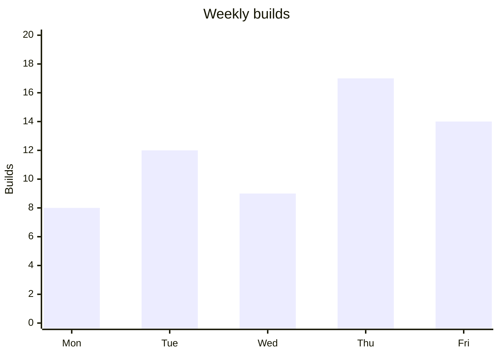

# Experimental Conversation GUI

In Settings → Presets, select a **Codex**, **Claude Code**, **Pi**, or **Antigravity** preset and enable **Conversation GUI · Experimental**. Open a new panel using that preset. Terminal remains the default. Each agent runs over its native structured local wire protocol while keeping ownership of its own tools, sandbox and permissions:

- **Codex (`codex`)**: `codex app-server --listen stdio://` (`CODEX_HOME`, dynamic tools `aya_present`, `aya_open_artifact`, `aya_progress`).
- **Pi (`pi`)**: `pi --mode rpc` (`PI_CODING_AGENT_DIR`, bundled Aya Pi extension registering `aya_present`, `aya_open_artifact`, `aya_progress` and interactive `extension_ui_request` tool approvals).
- **Claude Code (`claude`)**: `claude --input-format stream-json --output-format stream-json --verbose --include-partial-messages --permission-prompt-tool=stdio --chrome` (`CLAUDE_CONFIG_DIR`, in-band SDK MCP server `aya` for `aya_present`, `aya_open_artifact`, `aya_progress` and `can_use_tool` interactive approvals/questions).
- **Antigravity (`agy`)**: `agy --input-format stream-json --output-format stream-json` (`ANTIGRAVITY_GEMINI_DIR`, `step_update` streaming, `denied_actions` permission prompts, `ask_question` prompts, and `aya_present` / `aya_open_artifact` / `aya_progress` tool steps).

## Conversation

Responses stream as Markdown. A status beneath the latest response distinguishes working, waiting for your answer, completed, interrupted and failed turns. Tool activity stays in one expandable section; native plan updates appear as a compact checklist above the composer. Reading earlier messages pauses automatic scrolling, including when a queued message starts; **Jump to latest** returns to the current response.

Code fences with a language (`ts`, `python`, `sh`, etc.) render with syntax highlighting and a **Copy** button. Unknown languages and unlabelled fences remain plain, selectable code. Inline backtick code stays inline.

Images appear directly in messages with ``; paths can be relative to the workspace, absolute inside it, or local `file:` URLs. PNG, JPEG, WebP, GIF and SVG are supported up to 8 MiB. Base64 image data URLs also work. Click an image to enlarge it; Escape closes the preview. Remote images are not fetched.

Fenced `mermaid` blocks render diagrams and charts inline, including flowcharts, sequence diagrams, ER diagrams, pie charts and `xychart-beta` bar/line charts. **Show source** reveals the copyable definition. Invalid or incomplete diagrams show their source instead of breaking the message. Rendering is local and diagram links/scripts stay disabled. For example:

````markdown

````

Messages sent during a turn enter an editable queue. **Steer** sends a text follow-up into the current Codex turn; queued messages can also be steered, reordered or removed. Stop and reconnect hold the queue until you choose **Resume queue**. Model and reasoning options come from the installed Codex model catalog and apply to the next turn. Attach files and supported images with the + button. Images go through native Codex image input; other files are supplied as user-selected paths. Attachments awaiting delivery need reattaching after a reconnect.

The status bar's **snippets** button opens the same saved snippets in a GUI pane. A held snippet inserts at the message cursor; an auto-run snippet sends the resulting message, or adds it to the queue while the agent is working.

Conversation history, drafts, pending queue, goal, selected artifact and artifact versions are saved locally under Aya's config directory. Reopening the same panel resumes its native Codex thread. An interrupted turn is not automatically reissued, and a recovered queue stays paused. A resumed session must use the same workspace and account configuration.

## Subagents

A subagent appears in the tool activity as its own row: **Subagent (type): task** for a Claude Agent call, **Subagent: task** for a Codex spawned agent, and Codex's wait, message and close calls as **Waiting for 2 subagents** and so on. Expand the row to see the tools the subagent used (Claude) or each agent's last state (Codex), then its final report.

Claude Code runs subagents in the background by default: the turn that started one ends while it keeps working. Its row stays running, the turn status reads *1 subagent working in the background…*, and the pane stays *working* in the status rail. When the subagent finishes, Claude continues by itself in a new turn with a reply of its own.

An approval or question from a subagent says which subagent asked (*Requested by Subagent: Read the config*) and stays above the composer after the main turn ends, because the subagent is still waiting for the answer. A subagent's own messages never become the conversation's reply.

## Measured task progress

For tasks with measurable units, Codex is given the `aya_progress` tool. Call it with `label`, `current`, `total`, and optionally `detail`; it returns a `progressId`. Reuse that ID to update the existing bar. For example, decompiling ten functions can report 0/10, 4/10 and 10/10. Percentages are derived from these counts, never invented by Aya. Optional `status` is `running`, `complete`, `paused` or `failed`; completion requires current equal to total.

A running bar stays above the composer. Completed or stopped bars remain in conversation history. Ending a turn before the task is marked complete pauses its bar without changing the reported count. The tool is described in the GUI harness instructions; newly created Codex GUI threads receive it in their tool catalog.

## Artifacts

`aya_present` supports:

- `kind: "html"`, `title`, `html`: up to 2 MiB of HTML/CSS/JavaScript, including SVG, canvas and local video. Scripts run in an isolated frame with no Node, filesystem or network access. Embed dependencies and images instead of fetching them. `window.ayaWidget.suggest(text)` proposes a follow-up; the user reviews it and chooses **Add to message**, then sends it themselves.
- `kind: "image"`, `title`, `path`: PNG/JPEG/WebP/SVG files inside the workspace, up to 8 MiB, shown with zoom, keyboard panning and Fit. Unsupported or missing images show a visible error.
- `kind: "table"`, `title`, `columns`, `rows`: filterable tables with row follow-up suggestions.
- `kind: "metric"`, `title`, `value`, `description`: compact metric cards.

New artifacts keep the drawer closed by default. `open: true` opens and selects the result; `aya_open_artifact(artifactId)` reopens an existing artifact. Pass a previously returned `artifactId` to `aya_present` to update it. The latest ten versions are retained per artifact; reviewing an older version does not jump to a newer update.

Use **Previous/Next** (or Alt+Left/Right), title/content search, and the artifact picker to navigate. **Expand** fills the panel; Escape reduces it, then closes the drawer. HTML has Preview/Source tabs. HTML widgets and graphics can be saved or opened at the selected version:

- **Open window** creates a separate isolated Aya preview window. Widget suggestions still return to the conversation.
- **Open in browser** writes a standalone local preview and opens the system browser. In that standalone preview, widget actions show follow-up text to copy into Aya.

Panes that run as a terminal (TUI) can present the same kinds with `aya present`; see `tui-artifacts.md`.

### Local video and media

Use an HTML artifact containing ordinary media elements:

```html
<video controls preload="metadata" src="./demo.mp4"></video>
<!-- Alternative format, captions and a local poster also work. -->
<video controls poster="./poster.png">
  <source src="./demo.webm" type="video/webm">
  <track kind="captions" src="./captions.vtt" srclang="en">
</video>
```

Aya copies local `video`, `audio`, `source` and `track` sources, plus video posters, into content-addressed media storage.
Paths resolve relative to the supplied HTML file, or the workspace for inline HTML; GUI media must remain inside the
workspace, including symlink targets. MP4 (H.264/AAC) and WebM (VP8/VP9) are recommended. MP3/WAV/Ogg audio,
PNG/JPEG/WebP posters and WebVTT captions are also accepted. Limits are 256 MiB per file, 32 files and 512 MiB per artifact.
Embedded `data:` and `blob:` media also work, subject to the normal HTML size limit.

For players created by JavaScript, declare local paths in the tool's optional `assets` array, then resolve them with
`window.ayaWidget.asset(path)`. This returns an isolated preview URL, not a filesystem path. Aya streams media with byte
ranges for seeking; video bytes never enter conversation JSON or the renderer's artifact payload. Saved artifact versions
retain their media even if the original files are moved or removed. Unreferenced media is collected after seven days;
active previews and TUI artifacts keep their resources alive.

Saving an HTML artifact creates the selected `.html` file and a sibling `<name>.assets` directory. Keep both together
when sharing or moving it. Opening in a browser uses the same portable representation. External video URLs and embedded
YouTube/Vimeo iframes remain blocked; the preview displays an explanation instead of silently showing a broken player.

## Commands

Goal changes are also recorded as conversation entries; the goal bar shows a separate Active/Paused/Complete status and icon actions. Repeated token accounting updates do not duplicate goal entries.

- `/goal <objective>`, `/goal`, `/goal pause`, `/goal resume`, `/goal clear` use native thread goal operations with Codex; other adapters keep goal metadata in Aya.
- `/btw <question>` samples the completed thread context without adding a normal conversation turn. On Codex, `/btw` also works while the main turn runs: Aya forks the thread through the last finished turn into an ephemeral, read-only side thread and answers there, so the main turn is untouched.
- `/compact` requests native context compaction.
- Unsupported commands show an explicit error. CLI-only features remain available through Terminal mode.

Current limitations: local harnesses only; custom command flags are not applied; review, skills and MCP management are not exposed yet. The preset's **Unsafe approvals** setting does apply to GUI sessions and is shown in the conversation header: for Codex it uses full filesystem access and does not ask for approval. With that setting off, Codex uses workspace-write and on-request approvals. Existing Codex session records remain managed by Codex. Local conversation snapshots are limited to 32 MiB each.

The built-in **Violet** appearance applies the GUI prototype palette to Aya chrome and terminal defaults. Select **Settings → General → Appearance → Violet** in either development or packaged Aya. This is a saved, optional color scheme alongside System, Light and Dark; switching back removes the palette overrides. Explicit per-tab terminal themes retain their own colors.

## Conversation history

Use the history icon or `/resume [search]` to choose a conversation. The picker is scoped to the current project, account and harness, with title search, dates and a current-conversation marker. Aya saves drafts, rendered messages, goals and artifacts locally; switching requires an idle turn with no pending approvals. Resumed queues are held for review.

Codex also lists native CLI history through app-server `thread/list` and reads conversation turns through `thread/read`. Native conversations retain their original tool catalog: start a new conversation to get the latest Aya widget/progress tools. Other adapters currently list conversations saved in Aya; their pre-existing CLI histories are not imported.

`/new` and `/clear` start a fresh conversation while keeping history. `/help` lists GUI commands, `/model [name]` selects an available model (or focuses the model picker), and `/status` shows current model, workspace, goal and queue state. Unknown commands produce an error rather than becoming a prompt. Escape closes the history picker and returns focus to the composer; Tab stays inside it.

## Talking to the agent

- **Attention.** A GUI pane reports like a terminal agent running `aya status`: *working* while a turn runs, *waiting* with the question or the command when an approval or a question is pending, *done* and *error* when a turn ends. The status rail, the attention centre and the project badges treat it like any other pane. A turn restored from disk is history and reports nothing.
- **Approvals and questions** sit above the composer, where you type. For an approval, Ctrl/Cmd+Enter allows once and Ctrl/Cmd+Backspace declines (only while the draft is empty, so it never deletes text). With the focus outside a text field, the number keys pick the numbered option of a question.
- **While the agent works**, Enter queues or steers according to the toggle beside the send button (`Enter: queue` / `Enter: steer`, remembered), and Cmd/Ctrl+Enter does the opposite for one message. Cmd/Ctrl+Shift+Enter sends the oldest queued message into the running turn. Steering needs an agent that supports it and a text-only message.
- **The composer** recalls sent prompts with ArrowUp/ArrowDown (from an empty composer, while the text is unedited), stashes a draft with Cmd/Ctrl+S (in an empty composer the same key brings the latest back; the stash is kept per pane), and quotes an assistant reply: select words in it, then **Quote in composer** adds them as a Markdown block quote.
- **Find in conversation.** Cmd/Ctrl+F opens a find bar for the pane: Enter and Shift+Enter step through the matches, Escape closes it. Text inside a closed tool-activity section is not searched.
- **Turn timer.** *Working for 12s* while a turn runs and *Worked for 2m 07s* after it.

- `/plan` (or the Plan toggle) starts a Codex turn in plan mode. The proposed plan appears as a card with Copy, Show all and "Implement this plan", which switches back to default mode and sends it.
- Pasting more than 32 KB into the composer turns it into a text attachment instead of filling the box.
- Tool calls are grouped into phases (Explored, Edited, Ran, ...) and each row shows how long it took.
- `@ Context` inserts unsent diff review comments or the recent output of another terminal in the project into the draft. Comments inserted this way are not marked as sent, and terminal output works only for xterm panes.

Only Codex has side chat and plan mode so far.

## Claude in Chrome

Claude GUI starts with `--chrome`, so Chrome tools are available when the extension,
account and organization policy allow them. Install and sign in to the Claude in
Chrome extension and use a Claude subscription signed in through Claude Code;
API keys and setup tokens do not authenticate the browser extension.

Use `/chrome` or `/chrome status` to inspect the actual connection and paired browser.
`/chrome on`, `/chrome off` and `/chrome reconnect` use Claude Code's native MCP
controls. Stop a running turn before changing its browser connection. Site permissions
remain managed by the extension, and normal tool approvals still apply. Older Claude
Code versions that lack these controls show an explicit update/reconnect error.

## Claude usage

`/usage` reads Claude Code's native usage data without sending a model prompt. It
shows account-wide plan utilization and reset times separately from the current
session's API-equivalent cost and per-model input, output and cache token counts.
The cost estimate is not an extra subscription charge. Unknown or unavailable
limits are labelled as unavailable, rather than zero. The command works during
a running turn, skips the expensive local transcript-behavior scan and requires
a Claude Code version supporting the native `get_usage` control request.
