# Aya „Snow Leopard” Release — Kompleksowy Audyt Wydajności, Stabilności i Architektury

Wydanie w duchu **Mac OS X 10.6 Snow Leopard**: **zero nowych funkcji**, 100% skupienia na responsywności, redukcji zużycia CPU/RAM/baterii w spoczynku i pod obciążeniem, eliminacji zacięć głównego wątku, łataniu wycieków pamięci oraz spłaceniu długu architektonicznego.

```mermaid
flowchart LR
  subgraph P0["Fala 1: Krytyczne Wąskie Gardła & Błędy (P0)"]
    A["PTY / VT Checkpoint (CPU/GC)"]
    B["Idle Disk I/O (Config & Screen Rules)"]
    C["UI/DOM Jank (Split Drag, Diff, Chat)"]
    D["Krytyczne Bugi (TeamLog, SSH, ESRCH)"]
  end
  subgraph P1["Fala 2: Re-rendery, Cache & Wycieki (P1)"]
    E["Zepsute React.memo (Sidebar/StatusBar)"]
    F["Startup & Bundle (-45% JS, Async PATH)"]
    G["Wycieki Map/Timerów (PtyHost, Git, Refy)"]
  end
  subgraph P2["Fala 3: Higiena Architektury & Battery (P2)"]
    H["Deduplikacja do shared/ (~800 linii)"]
    I["Wyciszenie Timerów w Tle (Battery)"]
    J["Hardening Okien & Web Cache"]
  end
  P0 --> P1 --> P2
```

---

## 1. Potok PTY, VT Checkpointing i Renderowanie Terminala (Hot Path)

> [!CAUTION]
> Obecnie **każdy pojedynczy chunk** wyjścia z terminala uruchamia w `pty-host` pełną serializację całego bufora xterm (normal + alt scrollback) do Base64 + JSON oraz czterokrotne `JSON.stringify` mapy handlerów parsera.

### 1.1 Pełny zrzut bufora xterm do Base64/JSON (`capture`) i 4× `handlerShape` po każdym chunku PTY
- **Lokalizacja**: [vt-checkpoint.ts](file:///Users/hasik/Projects/aya/electron/vt-checkpoint.ts#L34-L61), [vt-checkpoint-binding.ts](file:///Users/hasik/Projects/aya/electron/vt-checkpoint-binding.ts#L50-L129), [vt-mirror.ts](file:///Users/hasik/Projects/aya/electron/vt-mirror.ts#L132-L140)
- **Przyczyna**:
  1. Przy każdym chunku PTY [`writeVtPane`](file:///Users/hasik/Projects/aya/electron/vt-mirror.ts#L132) wywołuje `pane.checkpoint.write(data)`.
  2. [`VtCheckpointTerminal.write`](file:///Users/hasik/Projects/aya/electron/vt-checkpoint.ts#L53) w callbacku wywołuje `this.append(...)`, które liczy `Buffer.byteLength(JSON.stringify(operation))` i planuje `queueMicrotask(() => this.compact())`.
  3. Gdy microtask się wykonuje (po niemal każdym chunku, bo `this.pending === 0 && ground(this.terminal)`), [`compact()`](file:///Users/hasik/Projects/aya/electron/vt-checkpoint.ts#L42-L51) wywołuje **`this.base = capture(this.terminal)`**!
  4. [`capture()`](file:///Users/hasik/Projects/aya/electron/vt-checkpoint-binding.ts#L93-L129) iteruje po wszystkich wierszach bufora normalnego i alternatywnego, konwertuje każdy `Uint32Array` wiersza do `Buffer` + `.toString("base64")`, klonuje obiekty przez `JSON.parse(JSON.stringify(...))` i serializuje całość do `Buffer.from(JSON.stringify(dto))`.
  5. Dodatkowo w trakcie jednego chunku 4 razy wywoływane jest [`assertOwnership`](file:///Users/hasik/Projects/aya/electron/vt-checkpoint-binding.ts#L67-L91) -> [`handlerShape`](file:///Users/hasik/Projects/aya/electron/vt-checkpoint-binding.ts#L50-L54), które za każdym razem sortuje klucze 4 map parsera i robi `JSON.stringify`.
- **Rozwiązanie**:
  - W [`assertOwnership`](file:///Users/hasik/Projects/aya/electron/vt-checkpoint-binding.ts#L67): zapisać `verifiedRegistrations: number` w `BindingState` i pomijać `handlerShape(term)`, dopóki licznik `state.registrations` się nie zmienił.
  - W [`VtCheckpointTerminal.compact()`](file:///Users/hasik/Projects/aya/electron/vt-checkpoint.ts#L42): gdy `this.pending === 0 && ground(this.terminal)`, żywa instancja `this.terminal` **już jest** w spójnym stanie `ground`. Zamiast serializować ją po każdym chunku, wystarczy wyczyścić `this.tail = []; this.tailBytes = 0; this.base = null;`, a kosztowne `capture(this.terminal)` wykonać **leniwie** dopiero wewnątrz [`checkpoint()`](file:///Users/hasik/Projects/aya/electron/vt-checkpoint.ts#L76) (lub gdy chunk zostawi parser poza `ground`). Eliminuje to >99% wywołań `capture()` podczas normalnej pracy.

### 1.2 Podwójna alokacja macierzy komórek i bezwarunkowe `explainPaneSnapshot` co 250 ms
- **Lokalizacja**: [pty-host-client.ts](file:///Users/hasik/Projects/aya/electron/pty-host-client.ts#L1568-L1575), [vt-state.ts](file:///Users/hasik/Projects/aya/electron/vt-state.ts#L15-L36), [vt-state.ts](file:///Users/hasik/Projects/aya/electron/vt-state.ts#L149-L186), [vt-state.ts](file:///Users/hasik/Projects/aya/electron/vt-state.ts#L240-L265)
- **Przyczyna**:
  1. W [`pty-host-client.ts`](file:///Users/hasik/Projects/aya/electron/pty-host-client.ts#L1572) przy każdym komunikacie `"snapshot"` (co 250 ms na aktywny panel) wywoływane jest:
     `this.notifyPaneWaiters(message.ptyId, explainPaneSnapshot(snapshot));`
     `explainPaneSnapshot(snapshot)` jest liczone **zanim** sprawdzimy, czy `this.paneWaiters.get(message.ptyId)` w ogóle ma jakichkolwiek oczekujących (w 99,9% przypadków nie ma!). Funkcja ta buduje syntetyczny terminal przez [`paneFromSnapshot`](file:///Users/hasik/Projects/aya/electron/vt-state.ts#L149) (alokując `new Map` dla każdego wiersza i obiekty domknięć `{ getChars, isDim, isInverse }` dla każdej komórki), po czym wynik jest natychmiast odrzucany.
  2. Linijkę niżej `acceptSnapshot` wywołuje [`snapshotStatus(snapshot)`](file:///Users/hasik/Projects/aya/electron/vt-state.ts#L257), które **drugi raz** wywołuje `paneFromSnapshot(snapshot)`, a następnie [`scan(pane)`](file:///Users/hasik/Projects/aya/electron/vt-state.ts#L15), które wywołuje `snapshotOf(pane)` (odbudowując nowy `VtSnapshot` z syntetycznego terminala!) i dwukrotnie woła `evaluateScreen`.
- **Rozwiązanie**:
  - Sprawdzać `if (this.paneWaiters.get(message.ptyId)?.size)` przed wywołaniem `explainPaneSnapshot(snapshot)`.
  - Przekazywać `snapshot.rows` bezpośrednio do `scan(pane, snapshot.rows)` i zwracać `{ waiting, verdict }`, unikając powtórnego `snapshotOf(pane)` i podwójnego `evaluateScreen`.

### 1.3 Sztorm 8× `ptyResize` (`SIGWINCH` bounce `r+1 -> r`) w 60 ms przy przełączeniu zakładki
- **Lokalizacja**: [TerminalView.tsx](file:///Users/hasik/Projects/aya/src/components/TerminalView.tsx#L583-L599), [TerminalView.tsx](file:///Users/hasik/Projects/aya/src/components/TerminalView.tsx#L1320-L1376)
- **Przyczyna**:
  - Przy kliknięciu zakładki terminala (`isVisible` i `wantsFocus` stają się `true`), [`forcePtyReassert`](file:///Users/hasik/Projects/aya/src/components/TerminalView.tsx#L583) jest wywoływane **4 razy**: w efekcie `isVisible` (linia 1329), synchronicznie w efekcie `wantsFocus` (linia 1361), w `requestAnimationFrame` (linia 1370) oraz w `setTimeout(..., 60)` (linia 1371).
  - Dla każdego TUI z focus reportingiem (`richInputRef.current === true`, np. Claude Code, Codex) pojedyncze `forcePtyReassert` wysyła `ptyResize(id, c, r + 1)` oraz `setTimeout(() => ptyResize(id, c, r), 0)`. Razem daje to **8 wywołań IPC `ptyResize` i 4 sygnały `SIGWINCH` `r+1 -> r` w 60 ms**, co powoduje migotanie TUI, resetuje timery stabilności screen-rules w `pty-core` i może nadpisać prawdziwy resize z `ResizeObserver`.
- **Rozwiązanie**:
  - Usunąć `forcePtyReassert()` z retry timerów focusu (`rAF` i `60ms` w `wantsFocus` powinny ponawiać wyłącznie `term.focus()`), a sam bounce `r+1 -> r` zdeduplikować jednym `reassertTimerRef` czyszczonym przy unmount/resize.

### 1.4 Brak szybkich ścieżek (fast-path) dla regexów ANSI/OSC w rendererze i `pty-host`
- **Lokalizacja**: [terminal-rendering.ts](file:///Users/hasik/Projects/aya/src/terminal-rendering.ts#L21-L38), [focus-reporting.ts](file:///Users/hasik/Projects/aya/src/focus-reporting.ts#L9-L18), [osc-extractor.ts](file:///Users/hasik/Projects/aya/electron/osc-extractor.ts#L80-L121), [pty-event-coalescer.ts](file:///Users/hasik/Projects/aya/electron/pty-event-coalescer.ts#L44-L124), [pty-core.ts](file:///Users/hasik/Projects/aya/electron/pty-core.ts#L477-L483)
- **Przyczyna**:
  - [`normalizeTerminalLinkUnderline`](file:///Users/hasik/Projects/aya/src/terminal-rendering.ts#L25) dla każdego chunku uruchamia regex `/\x1b\[([0-9:;]*)m/g` i dla **każdej** sekwencji koloru SGR alokuje tablicę `parameters.split(";")`, szukając rzadkiego `"4:5"`.
  - [`PtyEventCoalescer.push`](file:///Users/hasik/Projects/aya/electron/pty-event-coalescer.ts#L82) przy każdym dopisaniu chunku liczy `Buffer.byteLength(queued.chunk, "utf8")` na całym skumulowanym stringu ($O(K^2)$) oraz używa `JSON.stringify([...])` jako klucza strumienia.
  - [`getBufferedOutputSince`](file:///Users/hasik/Projects/aya/electron/pty-core.ts#L477) nawet gdy `offset === buffer.end` (brak nowych danych) robi `buffer.chunks.join("")` na buforze do 1 MB tylko po to, by wyciąć `.slice(buffer.total)` i zwrócić `""`.
  - [`matchingScreenRule`](file:///Users/hasik/Projects/aya/electron/agent-screen-rules.ts#L60-L68) w pętli po regułach wielokrotnie filtruje i łączy tablicę wierszy (`rows.filter(r => r.trim()).join("\n")`, ~30× na skan).
- **Rozwiązanie**:
  - Dodać SIMD-akcelerowane guardy `if (!chunk.includes("4:5")) return chunk;`, `if (!chunk.includes("3J")) return chunk;`, `if (!chunk.includes("\x1b[?1004")) return current;` oraz fast-path w `extractAyaOsc` gdy `carry === "" && !chunk.includes("\x1b]") && !chunk.endsWith("\x1b")`.
  - W `getBufferedOutputSince`: `if (offset === buffer.end) return { chunk: "", reset: false };`.
  - W `PtyEventCoalescer`: przechowywać `endOffset` w strukturze kolejki ($O(1)$).

---

## 2. Dysk I/O, Główny Wątek Electrona i Subprocesy

> [!WARNING]
> W stanie całkowitego spoczynku (idle) Aya wykonuje obecnie **od 60 do ponad 200 odczytów plików z dysku na sekundę** oraz co 1 sekundę wykonuje synchroniczne syscalle FS i rzuca wyjątek `ENOENT` na głównym wątku.

### 2.1 `startConfigWatcher` odczytuje wszystkie pliki co 500 ms + **BUG: Gubienie zmian zewnętrznych przy wielu oknach (`isEcho`)**
- **Lokalizacja**: [config-watcher.ts](file:///Users/hasik/Projects/aya/electron/config-watcher.ts#L40-L208), [config-echo.ts](file:///Users/hasik/Projects/aya/electron/config-echo.ts#L12-L61), [windows.ts](file:///Users/hasik/Projects/aya/electron/windows.ts#L252)
- **Przyczyna**:
  1. **Sztorm I/O**: [`createWindow`](file:///Users/hasik/Projects/aya/electron/windows.ts#L252) uruchamia osobny `startConfigWatcher(win)` dla każdego okna `BrowserWindow`. Mimo podpiętego `fs.watch`, każdy watcher uruchamia `setInterval(..., 500)` ([`WATCH_POLL_MS = 500`](file:///Users/hasik/Projects/aya/electron/config-watcher.ts#L40)), który co pół sekundy robi `fs.readFile` na `snippets.json`, `presets.json`, `themes.json` oraz `fs.readdir(PROJECTS_DIR)` + `fs.readFile` na **każdym pliku `.json` projektu** — bez wcześniejszego sprawdzenia `stat.mtimeMs`!
  2. **Multi-Window Bug (utrata synchronizacji drugiego okna)**: `startConfigWatcher(win)` tworzy osobną instancję na każde okno, ale [`config-echo.ts`](file:///Users/hasik/Projects/aya/electron/config-echo.ts#L12) współdzieli globalną mapę `lastWrittenHash`. Gdy plik projektu/konfiguracji zostanie zmieniony z zewnątrz (np. przez CLI) przy 2 otwartych oknach:
     - Watcher Okna 1 odczytuje plik, widzi `isEcho(...) === false`, wywołuje `recordWrite(filePath, content)` ([linia 78/134](file:///Users/hasik/Projects/aya/electron/config-watcher.ts#L78)) i wysyła `config:changed` do Okna 1.
     - Watcher Okna 2 chwilę później czyta ten sam plik, wywołuje `isEcho(filePath, content)`, które zwraca **`true`** (bo Okno 1 właśnie zapisało hash w `recordWrite`!) i **po cichu porzuca zdarzenie `config:changed`**, zostawiając Okno 2 ze starym stanem!
  3. Dodatkowo `writeFileAtomic` wywołuje `recordConfigWrite` dla każdego zapisu atomowego w aplikacji (w tym 32 MB snapshotów GUI, assetów i logów teamów), licząc SHA-256 i bezterminowo dopisując ścieżki do `lastWrittenHash`.
- **Rozwiązanie**:
  - Zrobić z `config-watcher` pojedynczy singleton w procesie main rozsyłający `config:changed` do wszystkich `ayaWindows` i `ayaWeb` (eliminuje to buga `isEcho` między oknami i mnożenie I/O przez liczbę okien).
  - W pętli pollowania sprawdzać najpierw `fs.stat` (`mtimeMs`, `size`) i czytać plik tylko przy zmianie metadanych.
  - W [`recordConfigWrite`](file:///Users/hasik/Projects/aya/electron/config-echo.ts#L14) śledzić wyłącznie pliki z katalogu konfiguracji/projektów.

### 2.2 Brak cache w `listProjects()` — N+2 sekwencyjnych odczytów z dysku na każde żądanie
- **Lokalizacja**: [config.ts](file:///Users/hasik/Projects/aya/electron/config.ts#L225-L285)
- **Przyczyna**:
  - [`listProjects()`](file:///Users/hasik/Projects/aya/electron/config.ts#L225) jest wołane przy każdym `pty:spawn`, co 5 s w `session-monitor`, przy każdej komendzie `control.ts`, co 15 s w `team-runner`, w `ci-checks`, `diff-comments` i `prompt-attachments`.
  - Każde wywołanie robi `fs.readdir(PROJECTS_DIR)`, w sekwencyjnej pętli `for ... await fs.readFile` parsuje każdy plik projektu, a na końcu czyta `projects-state.json`.
- **Rozwiązanie**:
  - Dodać cache w pamięci w `config.ts` inwalidowany przy zapisie/usunięciu projektu oraz przez `config-watcher`.

### 2.3 Synchroniczny skan FS co 1000 ms i ciągłe wyjątki `ENOENT` w `UserRuleProvider`
- **Lokalizacja**: [screen-user-rule-provider.ts](file:///Users/hasik/Projects/aya/electron/screen-user-rule-provider.ts#L111-L178), [screen-user-rule-data.ts](file:///Users/hasik/Projects/aya/electron/screen-user-rule-data.ts#L75-L125)
- **Przyczyna**:
  - [`UserRuleProvider.start()`](file:///Users/hasik/Projects/aya/electron/screen-user-rule-provider.ts#L112) odpala `setInterval(() => this.scan(), 1000)` na głównym wątku.
  - Gdy katalog `~/.aya/screen-rules` nie istnieje (domyślnie u prawie każdego użytkownika), co 1 sekundę `attachWatches()` wywołuje `fs.watch(this.directory)` rzucające wyjątek `ENOENT`, a `readUserScreenRules` wywołuje `lstatSync` rzucające kolejny `ENOENT`.
  - Gdy katalog istnieje, co 1 sekundę główny wątek synchronicznie otwiera deskryptory wszystkich plików (`openSync`, `readSync`, `lstatSync`), liczy SHA-256 i kompiluje regexy.
- **Rozwiązanie**:
  - Nie wywoływać `fs.watch` na nieistniejącym katalogu po stwierdzeniu `absent`; sprawdzać `lstatSync` `(mtimeMs, ctimeMs, ino)` przed ponownym czytaniem i haszowaniem plików.

### 2.4 Inne synchroniczne blokady głównego wątku (`fs.*Sync`, `DatabaseSync`, `scryptSync`, `execFileSync`)
- **Lokalizacje**:
  1. **Start aplikacji ([shell-path.ts](file:///Users/hasik/Projects/aya/electron/shell-path.ts#L52), [main.ts](file:///Users/hasik/Projects/aya/electron/main.ts#L346), [cli-path.ts](file:///Users/hasik/Projects/aya/electron/cli-path.ts#L27))**: `hydrateProcessPath()` wywołuje synchroniczne `execFileSync(shell, ["-ilc", ...])` **przed** `createWindow()`, blokując pokazanie okna na 300–3000 ms (szczególnie przy `nvm`/`conda`/`pyenv`).
  2. **Statusy agentów ([agent-status.ts](file:///Users/hasik/Projects/aya/electron/agent-status.ts#L35-L42))**: `persistWaiting()` używa synchronicznego i nieatomowego `fs.writeFileSync` przy każdej zmianie statusu `waiting`.
  3. **Logi debugowania teamów ([team-debug.ts](file:///Users/hasik/Projects/aya/electron/team-debug.ts#L32-L92))**: `statSync`, `renameSync`, `appendFileSync` przy każdym komunikacie control socketu.
  4. **SQLite + `/bin/ps -A` co 5 s na każdy panel w `watchAgentSession` ([agent-session.ts](file:///Users/hasik/Projects/aya/electron/agent-session.ts#L19-L109), [pty-prepare.ts](file:///Users/hasik/Projects/aya/electron/pty-prepare.ts#L175-L183))**: dla każdego otwartego panelu Codex/Claude/Grok co 5 sekund przez cały czas życia panelu spawnowany jest proces `/bin/ps -A -o pid=,ppid=` oraz otwierane są synchronicznie dwie bazy `~/.codex/state_N.sqlite` i `logs_N.sqlite` (często >100 MB) przez `DatabaseSync` na głównym wątku — nawet gdy `sessionId` zostało już znalezione! Co gorsza, [`pollSession`](file:///Users/hasik/Projects/aya/electron/agent-session.ts#L42) wywołuje `if (sessionId) report(sessionId)` bez deduplikacji, rozsyłając `{ type: "osc-session" }` przez IPC do wszystkich okien co 5 sekund na każdy panel.
  5. **Synchroniczne tworzenie próbnika XTerm i haszowanie `@xterm/headless` przy starcie modułów ([vt-checkpoint-binding.ts](file:///Users/hasik/Projects/aya/electron/vt-checkpoint-binding.ts#L8-L9), [linia 55](file:///Users/hasik/Projects/aya/electron/vt-checkpoint-binding.ts#L55-L57), [terminal-vt-checkpoint.ts](file:///Users/hasik/Projects/aya/src/terminal-vt-checkpoint.ts#L71))**: podczas importu modułów w main i rendererze (przed pierwszym paintem!) synchronicznie czytany i haszowany jest plik `@xterm/headless` z dysku oraz tworzona i niszczona jest tymczasowa instancja `new Terminal({ allowProposedApi: true })`.
  6. **Późne `app.requestSingleInstanceLock()` ([main.ts](file:///Users/hasik/Projects/aya/electron/main.ts#L447))**: wywoływane dopiero po utworzeniu `PtyHostClient`, `UserRuleProvider` i wystartowaniu watcherów (`userRuleProvider.start()`). Druga instancja (`aya <katalog>`) inicjalizuje cały stos zanim przekaże argumenty i zakończy działanie.
  7. **Logowanie Aya Web ([web-config.ts](file:///Users/hasik/Projects/aya/electron/web-config.ts#L125-L129))**: `crypto.scryptSync` blokuje event loop na ~50–100 ms przy każdym żądaniu `/api/login`.
  8. **Logi PTY ([pty-log.ts](file:///Users/hasik/Projects/aya/electron/pty-log.ts#L62)) i `spawnPty` ([pty-core.ts](file:///Users/hasik/Projects/aya/electron/pty-core.ts#L718))**: `fs.mkdirSync` przy każdym wierszu logu oraz `fs.statSync(cwd)` wewnątrz `async function spawnPty`.

### 2.5 Sztormy procesów i I/O w tle (`git diff --binary`, `usage-history`, `harness-search`, `/btw`)
- **Lokalizacje**:
  1. **[`workingTreeState`](file:///Users/hasik/Projects/aya/electron/git.ts#L463-L487)**: wołane co 15 s przez `team-runner`. Wykonuje do 5000 sekwencyjnych `await stat(...)`, a następnie spawnuje `git diff HEAD --binary` bez limitu bajtów, pompując potencjalnie setki MB binarnych diffów przez SHA-1 w procesie main. Zamiast diffowania zawartości plików wystarczy haszować wyjście `git status --porcelain=v2 -z -uall` + `(mtimeMs, size)` zmienionych plików.
  2. **[`scanUsageHistory`](file:///Users/hasik/Projects/aya/electron/usage-history.ts#L93-L119)**: odpala `Promise.all` z **6000 równoległych `fs.stat`** (zatykając pulę wątków libuv), parsuje `JSON.parse` na każdej linii do 512 MB plików JSONL bez pre-filtrowania (`line.includes('"token_count"')` / `line.includes('"usage"')`) i trzyma do 200 000 obiektów `Event` w globalnym `cache` na zawsze.
  3. **[`codexSessionFiles` & `codexSessionCwd`](file:///Users/hasik/Projects/aya/electron/harness-search.ts#L262-L372)**: przy każdym znaku wpisanym w wyszukiwarkę przechodzi całe drzewo `~/.codex/sessions/YYYY/MM/DD` bez cache'u; ponadto jeśli nowy plik `rollout-*.jsonl` jest jeszcze pusty (0 bajtów) w momencie pierwszego odczytu, `codexCwdCache.set(file, null)` **na stałe blokuje tę sesję na czas życia aplikacji**!
  4. **[`codex-gui-session.ts` (`/btw`)](file:///Users/hasik/Projects/aya/electron/codex-gui-session.ts#L134-L150)**: odpytuje `thread/turns/list` w pętli co `200 ms` (do 150 razy) zamiast nasłuchiwać strumienia powiadomień `turn/completed`.

---

## 3. Frontend React, DOM/CSS i Thrashing Persystencji

### 3.1 Przeciąganie splitu (`SplitResizeHandle`) zapisuje projekt na dysk i woła 5 setterów stanu przy każdym pikselu (60–120 Hz)
- **Lokalizacja**: [SplitResizeHandle.tsx](file:///Users/hasik/Projects/aya/src/components/SplitResizeHandle.tsx#L38-L41), [useSplitLayout.ts](file:///Users/hasik/Projects/aya/src/hooks/useSplitLayout.ts#L67-L116), [useSplitLayout.ts](file:///Users/hasik/Projects/aya/src/hooks/useSplitLayout.ts#L364)
- **Przyczyna**:
  - Każdy ruch myszy (`mousemove`) wywołuje [`updateProjectSplitTree`](file:///Users/hasik/Projects/aya/src/hooks/useSplitLayout.ts#L67), które **bez żadnego debounce'u** wywołuje `void window.aya.updateProject(updated)` (60–120 zapisów atomowych na dysk na sekundę!) oraz 5 setterów stanu Reacta (`setAllProjects`, `setProjects`, `setSingleViewByProject`, `setActiveLeafByProject`, `setActiveTabByProject` — przy czym 3 ostatnie zawsze tworzą nową referencję obiektu nawet gdy wartość się nie zmieniła).
  - Dodatkowo w [`useSplitLayoutView`](file:///Users/hasik/Projects/aya/src/hooks/useSplitLayout.ts#L364) funkcja `normalizeTreeForTabs` jest wołana w trakcie renderu bez `useMemo`.
- **Rozwiązanie**:
  - Zdebounce'ować zapis `window.aya.updateProject` przy resize splitu (np. 250 ms) i zwracać poprzedni stan w setterach pomocniczych, jeśli wartość dla `[slug]` się nie zmieniła.

### 3.2 `ConversationView`: synchroniczny reflow przy każdym znaku, $O(N^2)$ Markdown i serializacja IPC 4×/s podczas streamingu
- **Lokalizacja**: [ConversationView.tsx](file:///Users/hasik/Projects/aya/src/components/ConversationView.tsx#L177-L184), [ConversationView.tsx](file:///Users/hasik/Projects/aya/src/components/ConversationView.tsx#L225-L245), [ConversationView.tsx](file:///Users/hasik/Projects/aya/src/components/ConversationView.tsx#L379-L395)
- **Przyczyna**:
  1. **Brak tablicy zależności w `useLayoutEffect` ([linia 245](file:///Users/hasik/Projects/aya/src/components/ConversationView.tsx#L245))**:
     `useLayoutEffect(() => { if (!hidden) scrollToLatest(); });`
     Uruchamia się synchronicznie po **każdym renderze** — w tym po każdym pojedynczym znaku wpisanym w `<textarea>` promptu (`setPrompt`), wymuszając synchroniczny odczyt `viewport.scrollHeight` i reflow dokumentu!
  2. **Brak memoizacji wiadomości i niestabilny prop `components` ([linia 380](file:///Users/hasik/Projects/aya/src/components/ConversationView.tsx#L380))**: każdy delta token ze strumienia klonuje tablicę `messages` i powoduje ponowne parsowanie `ReactMarkdown` + `remarkGfm` dla **całej historii rozmowy** ($O(N^2)$).
  3. **Pełny zapis IPC co 250 ms w trakcie streamingu ([linie 225–232](file:///Users/hasik/Projects/aya/src/components/ConversationView.tsx#L225-L232))**: w trakcie szybkiego streamingu tokenów cały stan rozmowy + 100 KB wyjścia komend jest serializowany przez IPC i zapisywany na dysk 4 razy na sekundę.
- **Rozwiązanie**:
  - Dodać tablicę zależności `[hidden, messages, activities, turnError, liveThinking]` do `useLayoutEffect`.
  - Wydzielić `MemoizedMessageItem = React.memo(...)` ze stabilnym obiektem `components`.
  - Zapisywać stan po zakończeniu tury (`turn/completed`) oraz w debounce (np. 1500 ms od ostatniej delty).

### 3.3 Synchroniczne `highlight.js` wewnątrz pętli renderowania `DiffPanel` + 1 MB bundla startowego
- **Lokalizacja**: [StatusBar.tsx](file:///Users/hasik/Projects/aya/src/components/StatusBar.tsx#L3), [StatusBar.tsx](file:///Users/hasik/Projects/aya/src/components/StatusBar.tsx#L1233-L1261), [StatusBar.tsx](file:///Users/hasik/Projects/aya/src/components/StatusBar.tsx#L1405-L1445)
- **Przyczyna**:
  1. `import hljs from "highlight.js"` ładuje wszystkie **192 gramatyki języków (~950 kB zminifikowanego JS)** do głównego chunku startowego (`main.js` ma przez to 2,04 MB), mimo że `EXT_TO_LANGUAGE` mapuje tylko 20 rozszerzeń plików i używa ich wyłącznie po otwarciu `DiffPanel`.
  2. Wewnątrz [`DiffPanel`](file:///Users/hasik/Projects/aya/src/components/StatusBar.tsx#L1405) wywołanie `highlightCodeHtml(code, line.language)` (`hljs.highlight`) dzieje się **bezpośrednio w `.map()` podczas renderu bez `useMemo`**. Wpisanie pojedynczego znaku w komentarzu do diffu (`draft`) lub polu wyszukiwania (`query`) powoduje synchroniczne kolorowanie składni całego diffu od nowa na głównym wątku!
- **Rozwiązanie**:
  - Zaimportować `highlight.js/lib/core` (lub załadować leniwie przy otwarciu `DiffPanel`) z 20 używanymi językami (**-900 kB / -45% rozmiaru głównego bundla**).
  - Zmemoizować wynik `highlightCodeHtml` w `useMemo` zależnym tylko od `[lines]`.

### 3.4 Całkowicie ominięte `React.memo` na `Sidebar`, `StatusBar`, `ProjectsLeftLayout` i `PaneGrid`
- **Lokalizacja**: [App.tsx](file:///Users/hasik/Projects/aya/src/App.tsx#L737-L752), [App.tsx](file:///Users/hasik/Projects/aya/src/App.tsx#L1104-L1267), [App.tsx](file:///Users/hasik/Projects/aya/src/App.tsx#L1328-L1357), [PaneGrid.tsx](file:///Users/hasik/Projects/aya/src/components/PaneGrid.tsx#L64)
- **Przyczyna**:
  - `Sidebar`, `StatusBar` i `ProjectsLeftLayout` są opakowane w `React.memo`, ale `App.tsx` przekazuje do nich przy każdym renderze świeże funkcje strzałkowe inline (`onStartWorktrees`, `onOpenUsage`, `onGitStatusRefresh`, `onOpenTeams`, `onSpawnFailure`), świeże elementy JSX (`statusRail={<StatusRail ... />}`, `body={body ?? panesNode}`) oraz niestabilne tablice (`reviewTargets`, `resumePanes`), które zmieniają referencję przy każdej zmianie statusu dowolnego terminala.
- **Rozwiązanie**:
  - Ustabilizować callbacki przez `useCallback`, tablice `reviewTargets` i `resumePanes` przez `useStable`, oraz opakować `PaneGrid` i `ConversationView` w `React.memo`.

### 3.5 Nadmiarowy zapis wszystkich projektów przy zmianie jednego `sessionId`
- **Lokalizacja**: [useProjectPersistence.ts](file:///Users/hasik/Projects/aya/src/hooks/useProjectPersistence.ts#L380-L395)
- **Przyczyna**:
  - Gdy jeden terminal w Projekcie A otrzyma `sessionId`, efekt w `useProjectSessionPersistence` iteruje po **wszystkich** projektach mających jakikolwiek terminal z `sessionId || sharedDir` i wywołuje `persistProject(slug, ...)` dla każdego z nich.
- **Rozwiązanie**:
  - Śledzić sygnaturę `sessionId` per-projekt w `useRef<Record<string, string>>` i zapisywać wyłącznie ten projekt, którego sygnatura faktycznie uległa zmianie.

---

## 4. Krytyczne Błędy, Race Conditions i Wycieki Pamięci

| # | Kategoria | Lokalizacja | Opis problemu i naprawy |
| :--- | :--- | :--- | :--- |
| **4.1** | **Uszkodzenie danych (`log.jsonl`)** | [team-store.ts](file:///Users/hasik/Projects/aya/electron/team-store.ts#L384-L399) | `logTail()` wywołuje pojedyncze `await handle.read(buffer, 0, buffer.length, start)` bez pętli sprawdzającej `bytesRead` (w przeciwieństwie do `bounded-file-read.ts`). Krótki odczyt zostawia bajty `\0` na końcu bufora, `JSON.parse` rzuca wyjątek i zwraca `[]`, przez co `append()` resetuje `entry.id` z powrotem do **`1`**, psując kursory skrzynek odbiorczych teamu. Podobny brak pętli jest w [`usage-codex.ts`](file:///Users/hasik/Projects/aya/electron/usage-codex.ts#L307-L311). |
| **4.2** | **Błąd bezpieczeństwa / wiszące procesy SSH** | [remote-client.ts](file:///Users/hasik/Projects/aya/electron/remote-client.ts#L508-L515) | `runRemoteRequest` wywołuje `execFile("ssh", ["--", target, remoteCommand])` **bez `SSH_OPTIONS`** (`BatchMode=yes`, `ConnectTimeout=5`, `ControlMaster=no`, `PermitLocalCommand=no`) i bez grupy procesów (`detached: true`). Należy użyć `sshArgs` / `runSsh` z `electron/ssh.ts`. |
| **4.3** | **Nieobsłużony wyjątek `ESRCH` + wyciek `stderr`** | [multi-agent-gui-session.ts](file:///Users/hasik/Projects/aya/electron/multi-agent-gui-session.ts#L1504-L1510) | `AntigravityGuiSession.interrupt()` wywołuje `process.kill(-pid, 'SIGINT')` bez `try/catch` (gdy proces już zakończył działanie, rzuca synchroniczny wyjątek w procesie main). Ponadto wszystkie 4 klasy w tym pliku dopisują `this.stderr += String(chunk)` bez limitu długości (wystarczy `.slice(-1600)`). |
| **4.4** | **Bug przy zamykaniu projektu (`git[slug]`)** | [useProjectActions.ts](file:///Users/hasik/Projects/aya/src/hooks/useProjectActions.ts#L196-L200), [linia 255](file:///Users/hasik/Projects/aya/src/hooks/useProjectActions.ts#L255-L259) | `closeProject` i `releaseProject` wykonują `delete next[slug]` na stanie `git`, podczas gdy mapa `git` jest indeksowana po **ścieżce katalogu (`project.directory` oraz ścieżkach worktree)**, a nie po `slug`! Stan git zamkniętych projektów nigdy nie jest zwalniany. |
| **4.5** | **Wyciek 6 Map/Setów w `PtyHostClient`** | [pty-host-client.ts](file:///Users/hasik/Projects/aya/electron/pty-host-client.ts#L517-L531), [linia 1602](file:///Users/hasik/Projects/aya/electron/pty-host-client.ts#L1602-L1612) | `kill(ptyId)` oraz obsługa `exit` nie usuwają wpisów z `recoveryLaunches`, `latestRuleSnapshots` (pełne `VtSnapshot` z macierzą komórek!), `ruleStatusStates`, `observedPaneExits`, `uncertainInput` oraz `recoveryScreens`. |
| **4.6** | **Wyciek listenerów `destroyed` w oknach podglądu** | [artifact-preview-window.ts](file:///Users/hasik/Projects/aya/electron/artifact-preview-window.ts#L22-L23) | Każde otwarcie okna podglądu artefaktu podpina `owner.once('destroyed', ...)` do głównego okna, ale zamknięcie okna podglądu nigdy nie usuwa tego listenera (trzymającego domknięcie z referencją do zamkniętego `BrowserWindow`). |
| **4.7** | **Wycieki timerów/refów i polling w zminimalizowanym oknie** | [useLocalSummaries.ts](file:///Users/hasik/Projects/aya/src/hooks/useLocalSummaries.ts#L272-L288), [useTerminalSignals.ts](file:///Users/hasik/Projects/aya/src/hooks/useTerminalSignals.ts#L80-L95) | Zamknięcie terminala nie czyści `summaryTimersRef.current[id]`, `summaryMetaRef.current`, `lastActivityRef.current[id]` ani `mountDecided` w [`spawnSession.ts`](file:///Users/hasik/Projects/aya/src/spawnSession.ts#L68). Timery 800 ms (`useRecentTerminalActivity`) i 45 s (`useLocalSummaryEffects`) działają nawet gdy okno jest ukryte (`visibilityState === "hidden"`). |
| **4.8** | **Rekurencja przy utracie kontekstu WebGL** | [TerminalView.tsx](file:///Users/hasik/Projects/aya/src/components/TerminalView.tsx#L666-L709) | W [`attachWebgl`](file:///Users/hasik/Projects/aya/src/components/TerminalView.tsx#L684) handler `webgl.onContextLoss` wywołuje `attachWebgl(t)` synchronicznie; jeśli utrata kontekstu nastąpi wewnątrz `loadAddon` lub zanim GPU się zresetuje, `attachingWebglRef.current` blokuje ponowne podpięcie WebGL na stałe. |
| **4.9** | **Wyścig zapisu `projects-state.json` między oknami** | [projects-ipc.ts](file:///Users/hasik/Projects/aya/electron/ipc/projects-ipc.ts#L38-L44) | Równoległe `projects:save-state` z dwóch okien (lub `releaseWindowSlices` przy zamykaniu okna) czytają i nadpisują `projects-state.json` bez kolejki serializującej (`oneAtATime`). |

---

## 5. Architektura, Deduplikacja (`shared/`) i Drobne Usprawnienia

### 5.1 ~800 linii zduplikowanego kodu między `src/` a `electron/`
Mimo że projekt posiada katalog `shared/` widoczny z obu konfiguracji TypeScript, aż kilkanaście modułów jest skopiowanych pomiędzy `src/` i `electron/`:
- **100% identyczne kopie**:
  - [src/terminal-vt-checkpoint.ts](file:///Users/hasik/Projects/aya/src/terminal-vt-checkpoint.ts) (353 linie) === [electron/vt-checkpoint-binding.ts](file:///Users/hasik/Projects/aya/electron/vt-checkpoint-binding.ts) + [electron/vt-checkpoint.ts](file:///Users/hasik/Projects/aya/electron/vt-checkpoint.ts) (357 linii)
  - [src/units.ts](file:///Users/hasik/Projects/aya/src/units.ts) === [electron/units.ts](file:///Users/hasik/Projects/aya/electron/units.ts)
  - [src/update-spawn.ts](file:///Users/hasik/Projects/aya/src/update-spawn.ts) === [electron/update-spawn.ts](file:///Users/hasik/Projects/aya/electron/update-spawn.ts)
- **Bliskie duplikaty (ryzyko rozjechania się logiki)**:
  - [src/split-tree.ts](file:///Users/hasik/Projects/aya/src/split-tree.ts) (323 linie) vs [electron/split-tree.ts](file:///Users/hasik/Projects/aya/electron/split-tree.ts) (201 linii)
  - [src/local-summary-errors.ts](file:///Users/hasik/Projects/aya/src/local-summary-errors.ts) vs [electron/local-summary-errors.ts](file:///Users/hasik/Projects/aya/electron/local-summary-errors.ts)
  - [src/ollama-defaults.ts](file:///Users/hasik/Projects/aya/src/ollama-defaults.ts) vs [electron/aya-intelligence.ts](file:///Users/hasik/Projects/aya/electron/aya-intelligence.ts#L9-L12)
  - 3 osobne implementacje `stripAnsi` ([text.ts](file:///Users/hasik/Projects/aya/electron/text.ts#L6), [control.ts](file:///Users/hasik/Projects/aya/electron/control.ts#L156), [usage-grok.ts](file:///Users/hasik/Projects/aya/electron/usage-grok.ts#L62))

### 5.2 Animacja CSS `box-shadow` na głównym wątku i `localStorage` przy każdym klawiszu
- **CSS ([app.css](file:///Users/hasik/Projects/aya/src/styles/app.css#L538-L541))**: `@keyframes aya-pulse` animuje `box-shadow` na kropkach statusu, co wymusza przeliczanie paintu na głównym wątku w 60 FPS dla każdego działającego terminala. Zamiana na `opacity` / `transform: scale()` przenosi animację na wątek kompozytora GPU.
- **Terminal Input ([TerminalView.tsx](file:///Users/hasik/Projects/aya/src/components/TerminalView.tsx#L1131-L1132), [linia 1687](file:///Users/hasik/Projects/aya/src/components/TerminalView.tsx#L1687))**: wewnątrz `term.onData` przy każdym naciśnięciu klawisza wywoływane jest synchroniczne `localStorage.getItem(DEBUG_TERMINAL_INPUT_STORAGE_KEY)` oraz bezwarunkowe `setIsScrollbarHidden(true)` (a przy każdym ticku scrolla `onWheelCapture={() => setIsScrollbarHidden(false)}`).

### 5.3 Higiena Bundla, Paczkowania (`app.asar`), Zapisów Atomowych i Timerów Idle
- **591 KB zduplikowanych fontów `.woff` ([fonts.ts](file:///Users/hasik/Projects/aya/src/fonts.ts#L3-L10))**: domyślne arkusze `@fontsource` dołączają 43 pliki `.woff` obok `.woff2`, mimo że Electron (Chromium) używa wyłącznie `.woff2`.
- **20 osieroconych plików `.js` i 231 plików `.d.ts` w `dist-electron/` ([package.json](file:///Users/hasik/Projects/aya/package.json#L27), [linia 117](file:///Users/hasik/Projects/aya/package.json#L117))**: przez brak czyszczenia `dist-electron` przed kompilacją z `incremental: true`, usunięte dawniej moduły oraz deklaracje `.d.ts` trafiają prosto do produkcyjnego `app.asar`.
- **Niespójne zapisy atomowe omijające [`atomic-write.ts`](file:///Users/hasik/Projects/aya/electron/atomic-write.ts#L13-L33)**: funkcje `replaceJsonl` w [team-store.ts](file:///Users/hasik/Projects/aya/electron/team-store.ts#L43-L47), `flush` w [cli-adoption.ts](file:///Users/hasik/Projects/aya/electron/cli-adoption.ts#L161-L164) oraz `markPendingUpdateSync` w [update-recovery.ts](file:///Users/hasik/Projects/aya/electron/update-recovery.ts#L134-L139) ręcznie tworzą pliki `.tmp` bez flagi `wx`, losowego sufiksu lub sprzątania po błędzie `rename`.
- **Zbędne wybudzenia timerów w spoczynku**:
  - [`useDockBadge`](file:///Users/hasik/Projects/aya/src/hooks/useTerminalSignals.ts#L16-L24) wysyła IPC `app:set-dock-badge` przy każdej zmianie dowolnego pola w `terminals`, nawet gdy `waitingCount` się nie zmieniło.
  - [`MachinesStatus.tsx`](file:///Users/hasik/Projects/aya/src/components/MachinesStatus.tsx#L38-L39) odpytuje `machinesStatus()` co 30 s nawet wtedy, gdy użytkownik ma 0 skonfigurowanych maszyn zdalnych.
  - [`team-ipc.ts`](file:///Users/hasik/Projects/aya/electron/ipc/team-ipc.ts#L45-L52) co 15 s czyta z dysku `~/.aya/relaunch-notes.json` i uruchamia `redeliverWaiting()`, nawet gdy nie ma żadnych aktywnych teamów ani notatek relaunchu.

---

## Proponowany Plan Realizacji (3 Fale)

1. **Fala 1 (P0 — Maksymalny przyrost wydajności i naprawa groźnych bugów)**:
   - Leniwe `capture()` i fast-path `assertOwnership` w `vt-checkpoint` + eliminacja podwójnego `paneFromSnapshot` / `explainPaneSnapshot` w `pty-host-client` i `vt-state`.
   - Naprawa 4× `forcePtyReassert` (`8× ptyResize`) przy przełączaniu zakładek w `TerminalView.tsx` + fast-pathy SGR/OSC.
   - Singleton `config-watcher` oparty o `stat.mtimeMs`, cache w `listProjects()` oraz naprawa 1 Hz synchronicznego skanu w `screen-user-rule-provider.ts`.
   - Debounce zapisu projektu przy przeciąganiu `SplitResizeHandle`, brakująca tablica zależności `useLayoutEffect` i memoizacja wiadomości w `ConversationView`, memoizacja + odchudzenie `highlight.js` w `StatusBar`.
   - Naprawa pętli odczytu w `TeamStore.logTail()` / `usage-codex.ts`, dodanie `SSH_OPTIONS` w `runRemoteRequest`, `try/catch` + limit `stderr` w `multi-agent-gui-session.ts`.
2. **Fala 2 (P1 — Re-rendery Reacta, czas startu, wycieki pamięci)**:
   - Naprawa `React.memo` dla `Sidebar`, `StatusBar`, `ProjectsLeftLayout`, `PaneGrid` + `React.lazy` dla modali.
   - Asynchroniczne `hydrateProcessPath()`, `scrypt`, `agent-status` i optymalizacja `workingTreeState` / `usage-history` / `harness-search`.
   - Czyszczenie map w `PtyHostClient`, `git[directory]` w `useProjectActions`, `lastActivityRef`, `summaryTimersRef` i listenerów `artifact-preview-window`.
3. **Fala 3 (P2 — Deduplikacja do `shared/`, oszczędzanie baterii w tle, hardening)**:
   - Przeniesienie zduplikowanego kodu (`vt-checkpoint`, `split-tree`, `units`, `update-spawn`, `local-summary-errors`) do `shared/`.
   - Przełączenie timerów tła (`useRecentTerminalActivity`, `useLocalSummaryEffects`, `useMinuteTick`) na `pollVisible` / tryb uśpienia w spoczynku + animacja `aya-pulse` na GPU.
